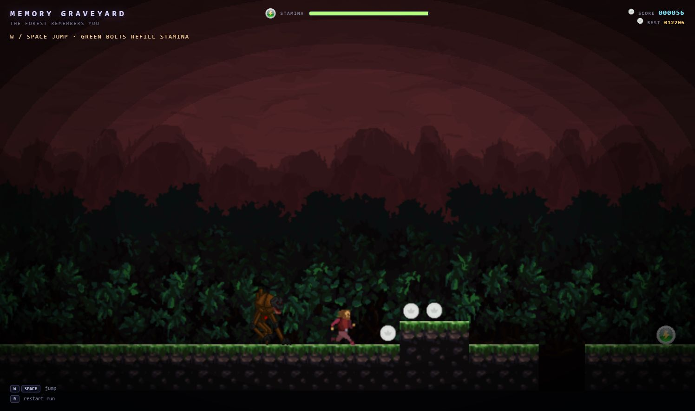

# Memory Graveyard



An endless side-scrolling forest run. The forest remembers you, and something
made of its discarded memories is always just behind. Coins feed the score,
green bolts feed your stamina, and a missed jump is the end.

## Controls

| Action | Keyboard |
| --- | --- |
| Jump | `Space` or `W` |
| Restart run | `R` |

The player auto-runs. Arrow keys are intentionally unbound.

## Run it

```bash
pnpm install
pnpm dev
```

The app boots straight to the **title screen**.

```bash
pnpm test       # headless logic tests
pnpm typecheck
pnpm build      # static production build in dist/
pnpm preview
```

Built with:

- **Excalibur.js** 0.32 (Arcade physics solver)
- **TypeScript** 7
- **Vite** 8
- **Vitest** 5
- **pnpm**

Everything is client-side; there is no backend.

> **Branch:** the final product lives on `main`. The previous editor/campaign
> build is preserved in [`archive/old-system`](archive/old-system/) and tagged
> `archive/old-system-2026-11-12`.

## How a run works

- **Play** starts an endless, seeded forest made of streamed acts.
- Each act adds pits, raised ground and floating platforms.
- **Coins** are worth 100 points each, on top of 1 point per 10 px travelled.
- **Green bolts** refill 25 stamina. Stamina drains continuously; at zero the
  player slows to a crawl and the Shade closes the gap.
- The **Shade** follows the trail the player has already run, including every
  jump and drop.
- Falling into a pit shows **YOU FELL**; being caught shows **CAUGHT**. Both offer
  Retry or Back to Home Menu.
- The best score is saved in `localStorage` and shown on the title and run HUD.

## Architecture

```text
src/
  main.ts                     boot: manifest + settings + engine
  game/
    app.ts                    title / options / credits / run scene graph
    assets.ts                 Pixel pack, hero frames, Shade, coin, bolt
    config.ts                 gameplay tunables + palette
    physics/collisionGroups.ts bitmask collision groups
    player/
      PlayerController.ts     pure run/jump/coyote/buffer decisions (testable)
      Player.ts               Excalibur actor: input, body, tile ground probe
    input/actions.ts          jump action map
    chase/trail.ts            pure trail recorder + follower (testable)
    actors/
      Monster.ts              trail-following pursuer
      CoinPickup.ts           score coin sprite + bob
      StaminaBolt.ts          stamina bolt sprite + bob
    level/
      schema.ts               level grid format + validator
      manifest.ts             asset manifest: tile id -> art + collision
      tiles.ts                grid reshaping + horizontal run merging
      loader.ts               level grid + manifest -> live actors
      scenery.ts              scenery preset painter
    scenery.ts                the Pixel forest backdrop preset
    run/
      generator.ts            seeded acts, pits, raised sections, speed curve
      actStream.ts            builds/recycles acts and pickups
      score.ts                distance + coin score
      stamina.ts              drain, refill and spacing tuning
    camera/CameraFollow.ts    deadzone follow
    scenes/RunScene.ts        run loop, pickups, stamina, score, death UI
    menus/                    Title / Options / Credits / Preview (DOM)
    storage/                  settings + safe localStorage
    ui/                       analog FX, toast HUD, mode helpers
    visuals/                  Shade and hero animation builders
public/
  assets/manifest.json        the two used moss tiles
  assets/pixel-platformer-world/  moss tiles, forest backgrounds, hero frames
  assets/enemies/dark-fantasy-monster-2/  Shade sprite sheet
  assets/audio/               music, ambience, footsteps
  assets/analog-fx/           LESED Vignette
  assets/ui/                  coin, bolt and licence notices
tests/                        headless vitest suite
archive/old-system/           read-only snapshot of the editor/campaign build
CREDITS.md                    asset attribution
docs/ASSETS.md                art/audio licence rules
docs/KNOWN_ISSUES.md          deliberately deferred quirks
licenses/                     full licence texts (CC0, CC-BY)
```

### Key decisions

- **Excalibur's Arcade solver**, not the Realistic (matter.js) solver. It runs on
  the engine's variable timestep; a fixed step is opt-in via `PHYSICS.fixedFps`.
- **Pure movement decisions.** Gravity, acceleration, variable-height jump,
  coyote time and jump buffering live in `PlayerController`, which has no
  Excalibur imports and is replayed deterministically in tests.
- **Streamed acts, not authored levels.** `ActStream` keeps roughly two screens
  of terrain ahead of the player and recycles what falls behind, so the run never
  ends and memory use stays flat.
- **Seeded generation.** `generator.ts` contains the pure act layout rules, so a
  run can be reproduced from its seed in tests.
- **Pickups are sensors.** Coins and bolts use `PreventCollision` bodies and are
  collected by AABB overlap, so they can never block a jump.
- **Deterministic ground probe.** Arcade does not report a resting ground contact
  on every step, so the player probes the act surface directly. A short event
  latch bridges gaps; coyote time keeps jumps forgiving.
- **Pit detection uses the player's centre.** The fall starts once the centre
  is over the pit at floor level. The falling player stops using the ground
  probe, so it cannot re-ground on the far lip and glide through tiles.
- **DOM menus and HUD over the canvas** keep labels crisp at any resolution.

## Assets & credits

- [`CREDITS.md`](CREDITS.md) records every shipped asset.
- [`docs/ASSETS.md`](docs/ASSETS.md) defines the 32px pixel-art targets, accepted
  licences and review flow.
- [`docs/PAGES.md`](docs/PAGES.md) records the GitHub Pages issues and fixes.
- [`licenses/`](licenses/) holds the full licence texts (CC0 and CC-BY).
- The forest uses the Pixel Platformer World moss tiles and six backdrop layers.
- The Sound Guild footsteps are still a placeholder pending course approval;
  the pack is credited but not redistributed as a standalone pack.

## Known issues

See [`docs/KNOWN_ISSUES.md`](docs/KNOWN_ISSUES.md). The main open item is the
footstep licence confirmation.

## Testing

- `pnpm test` — pure generator, score, stamina, schema, manifest, scenery and
  controller logic in Vitest.
- `pnpm typecheck` and `pnpm build` — strict TypeScript and production bundle.

## Archive

The old editor, campaign, level select, sequences and authored levels are kept
for comparison in [`archive/old-system`](archive/old-system/). They are a
read-only snapshot and are not compiled, bundled or served by the final build.
